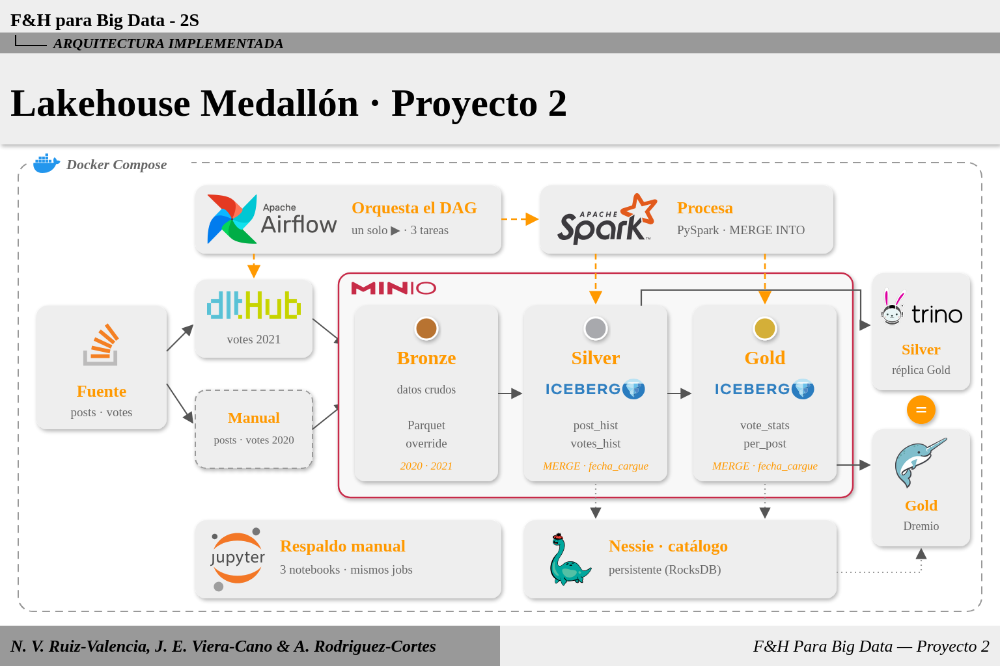

# Proyecto 2 · Lakehouse Medallón con dlt, Spark, Iceberg/Nessie, Airflow, Trino y Dremio

**Frameworks y Herramientas para Big Data** · UAO · Prof. Oscar Andrés Jiménez Villanueva

Arquitectura Lakehouse *open source* desplegada con Docker Compose. Implementa la arquitectura **Medallón (Bronze → Silver → Gold)** sobre el dataset **StackOverflow** (tablas **Posts** y **Votes**):

| Capa | Formato y escritura | Contenido |
|---|---|---|
| **Bronze** (bucket `bronze`) | Parquet, **sobrescritura (override)** | Datos crudos anuales: `posts_2020`, `posts_2021`, `votes_2020`, `votes_2021` |
| **Silver** (bucket `silver`) | Iceberg, **MERGE INTO** + `fecha_cargue` | Tablas históricas curadas: `silver.post_hist`, `silver.votes_hist` |
| **Gold** (bucket `gold`) | Iceberg, **MERGE INTO** + `fecha_cargue` | Métricas: `gold.vote_stats_per_post` (votos por post, a partir de las 2 tablas de Silver) |



> Versión vectorial: [`docs/arquitectura.svg`](docs/arquitectura.svg). Los problemas que encontramos durante la construcción y cómo se resolvieron están en la [sección 10](#10-problemas-encontrados-y-soluciones).

---

## 1. Componentes

| Servicio | Función | Imagen | URL / puerto |
|---|---|---|---|
| **MinIO** | Object storage S3 (buckets `bronze`, `silver`, `gold`, `warehouse`) | `pgsty/minio:RELEASE.2026-08-04T00-00-00Z` | consola http://localhost:9001 · API :9000 |
| **Nessie** | Catálogo de las tablas Iceberg (**persistente con RocksDB**) | `ghcr.io/projectnessie/nessie` | http://localhost:19120 |
| **Apache Iceberg** | Formato de tablas de Silver y Gold | (JARs en la imagen de Spark) | — |
| **Apache Spark 3.5.5** | Procesamiento con PySpark (master + 1 worker) | `p2-spark` (build local) | UI http://localhost:9090 · `spark://spark-master:7077` |
| **Apache Airflow 2.9** | Orquestación del DAG (LocalExecutor + Postgres) | `p2-airflow` (build local) | http://localhost:8080 |
| **dlt** | Ingesta a Bronze (fuente HTTP → MinIO en Parquet) | (en las imágenes de Airflow y Jupyter) | — |
| **Jupyter Lab** | Ejecución manual alterna (notebooks de respaldo) | `p2-jupyter` (build local) | http://localhost:8888 |
| **Trino 476** | Motor SQL: consulta **Silver** y replica Gold | `trinodb/trino:476` | http://localhost:8085 |
| **Dremio 26** | Motor SQL: consulta **Gold** | `dremio/dremio-oss:26.0` | http://localhost:9047 |

### Accesos

Las claves **no están en el repositorio**: se definen en el archivo `.env` (ver la sección 3).

| Servicio | Usuario | Clave |
|---|---|---|
| MinIO (consola :9001) | `MINIO_ROOT_USER` | `MINIO_ROOT_PASSWORD` |
| Airflow (:8080) | `AIRFLOW_ADMIN_USER` | `AIRFLOW_ADMIN_PASSWORD` |
| Dremio (:9047) | `DREMIO_USER` | `DREMIO_PASSWORD` (el usuario lo crea `scripts/configurar_dremio.sh`) |
| Trino (:8085, DBeaver) | `admin` (cualquier nombre) | sin clave |
| Jupyter (:8888) | — | sin token |
| Postgres de Airflow (interno) | `POSTGRES_USER` | `POSTGRES_PASSWORD` |

---

## 2. Requisitos

- Docker Engine 24+ con Docker Compose v2.
- **RAM:** al menos 14 GB en el equipo (el stack completo usa unos 9–10 GB: Dremio 4–5 GB, Trino hasta 3 GB, Spark 3 GB).
- **Disco:** unos 25 GB (imágenes unos 15 GB y dataset descargado unos 6 GB).
- Puertos libres: 8080, 8081, 8085, 8888, 9000, 9001, 9047, 9090, 7077, 19120, 31010, 32010. Si hay otro stack del curso corriendo, hay que bajarlo antes (`docker compose down` en su carpeta).

---

## 3. Despliegue

```bash
# 1. Variables y claves
cp .env.example .env
#    editar .env: claves de MinIO, Postgres, Airflow y Dremio; AIRFLOW_UID=$(id -u) en Linux;
#    DATOS_LOCALES = carpeta donde se descargará el dataset (por defecto ./datos)

# 2. Construir las imágenes (Spark, Jupyter y Airflow) — la primera vez tarda ~10 min
docker compose build

# 3. Inicializar Airflow (BD, usuario admin y conexión spark_default)
docker compose up airflow-init

# 4. Levantar todos los servicios
docker compose up -d
docker compose ps          # todos "Up"; minio-init y airflow-init terminan con "Exited (0)"
```

`minio-init` crea los buckets `bronze`, `silver`, `gold` y `warehouse` cada vez que arranca (si ya existen, no hace nada).

---

## 4. Carga de datos

### 4.1 Alcance (aclaración del enunciado)

- Se usan **dos años (2020 y 2021)** de **dos tablas** (posts y votes), con **el mismo rango de meses en ambos años (enero–marzo)**, para que el join tenga coincidencias y quepa en la RAM. El rango se cambia en `jobs/comun.py` (`MES_INICIO`, `MES_FIN`).
- **Manual (una sola vez):** `posts_2020`, `posts_2021` y `votes_2020` a Bronze, y la tabla histórica `silver.post_hist`.
- **Por el pipeline de Airflow:** `votes_2021` (dlt) → `silver.votes_hist` → `gold.vote_stats_per_post`.

### 4.2 Carga manual (antes del primer DAG)

```bash
# Descarga posts 2020, posts 2021 y votes 2020 (~6 GB) a $DATOS_LOCALES/raw
bash scripts/descargar_dataset.sh

# Bronze manual: filtra enero–marzo, deja solo las columnas usadas y sube los Parquet a MinIO
docker compose exec jupyter python /workspace/scripts/bronze_manual.py

# Silver manual: consolida posts_2020 + posts_2021 en nessie.silver.post_hist (Iceberg, MERGE)
docker compose exec spark-master /opt/spark/bin/spark-submit \
    --master spark://spark-master:7077 --total-executor-cores 2 --executor-memory 2g \
    /opt/spark/jobs/silver_post_hist_manual.py
```

**En Windows:**
- La descarga tiene versión para PowerShell (no necesita Git Bash):
  ```powershell
  powershell -ExecutionPolicy Bypass -File scripts\descargar_dataset.ps1
  ```
- Si se usa Git Bash y aparece `set: pipefail\r: invalid option name` (o `$'\r': command not found`), el archivo quedó con finales de línea de Windows (CRLF). El `.gitattributes` del repo fuerza LF en los `.sh`; si el clon es anterior, se corrige con:
  ```bash
  git rm --cached -r . -q && git reset --hard      # vuelve a sacar los archivos con LF
  # o, solo para un archivo:  sed -i 's/\r$//' scripts/descargar_dataset.sh
  ```
- Los comandos `docker compose exec …` son iguales en PowerShell; en una sola línea, sin las `\` de continuación.

### 4.3 Configurar Dremio (una sola vez)

```bash
bash scripts/configurar_dremio.sh
```

Crea el usuario administrador y la fuente **`nessie`**. Requiere bash y `python3` (en Windows: Git Bash con Python instalado; si no, hacerlo desde la UI como se indica a continuación). Para hacerlo a mano en la UI: *Add Source → Nessie*:
- **General:** endpoint `http://nessie:19120/api/v2`, autenticación `None`.
- **Storage:** AWS root path `/warehouse`, Access Key y Secret con las claves de MinIO, *Encrypt connection* desactivado.
- **Propiedades:** `fs.s3a.endpoint=minio:9000`, `fs.s3a.path.style.access=true`, `dremio.s3.compat=true`.

---

## 5. Pipeline en Airflow (un solo ▶ Play)

1. Abrir http://localhost:8080 e iniciar sesión.
2. Abrir el DAG **`medallon_stackoverflow`** y pulsar **▶ Trigger DAG**.

| # | Tarea | Operador | Qué hace |
|---|---|---|---|
| 1 | `bronze_ingest` | `BashOperator` → `jobs/bronze_ingest.py` | **dlt** descarga `votes/2021.parquet` por HTTP, filtra enero–marzo y escribe `s3://bronze/votes/votes_2021/` en **Parquet** con `write_disposition="replace"` (**override**) |
| 2 | `silver_transform` | `SparkSubmitOperator` → `jobs/silver_transform.py` | Une votes 2020 + 2021, normaliza (snake_case, tipos, catálogo de tipos de voto, nulos), quita duplicados, agrega `fecha_cargue` y hace **`MERGE INTO nessie.silver.votes_hist`** |
| 3 | `gold_agg` | `SparkSubmitOperator` → `jobs/gold_agg.py` | Cruza **`post_hist ⋈ votes_hist`**, calcula las métricas por post y hace **`MERGE INTO nessie.gold.vote_stats_per_post`** con `fecha_cargue` |

- Duración aproximada del DAG completo: **2–3 minutos**.
- Las tareas 2 y 3 se envían al **clúster de Spark**. Se ven en http://localhost:9090 (*Completed Applications*: `silver_transform`, `gold_agg`).
- **Idempotencia:** volver a ejecutar el DAG no duplica filas. Bronze se reemplaza; Silver y Gold hacen MERGE (insertan lo nuevo, actualizan solo lo que cambió y, en Gold, borran posts que ya no tengan votos). Cada ejecución deja un **snapshot** nuevo en Iceberg.

Por línea de comandos: `docker compose exec airflow-scheduler airflow dags trigger medallon_stackoverflow`.

---

## 6. Ejecución manual (respaldo si falla Airflow)

En http://localhost:8888 → carpeta `notebooks/`. Abrir cada notebook y ejecutarlo completo (*Run All*), en este orden:

| Notebook | Equivale a la tarea |
|---|---|
| `bronze_ingest.ipynb` | `bronze_ingest` (dlt → Bronze) |
| `silver_transform.ipynb` | `silver_transform` (Bronze → `silver.votes_hist`); tiene una celda opcional para reconstruir `silver.post_hist` |
| `gold_agg.ipynb` | `gold_agg` (Silver → `gold.vote_stats_per_post`); termina con una prueba Gold recalculado = Gold escrito |

Los notebooks importan **las mismas funciones de `jobs/`** que ejecuta Airflow, así que la lógica es idéntica. Las sesiones de Spark también corren en el clúster.

---

## 7. Consumo y validación (Trino → Silver, Dremio → Gold)

La prueba consiste en **replicar la tabla Gold con una consulta SQL sobre las tablas de Silver en Trino** y compararla con **la tabla Gold consultada en Dremio**: deben coincidir el número de filas y los valores.

| Archivo | Motor | Qué consulta |
|---|---|---|
| [`consultas/trino_replica_gold.sql`](consultas/trino_replica_gold.sql) | Trino | `iceberg.silver.post_hist` ⋈ `iceberg.silver.votes_hist` → réplica de Gold |
| [`consultas/dremio_gold.sql`](consultas/dremio_gold.sql) | Dremio | `nessie.gold.vote_stats_per_post` |

Las consultas están numeradas en pares (1 ↔ 1, 2 ↔ 2…):

| # | Qué comparar | Resultado esperado (enero–marzo 2020/2021) |
|---|---|---|
| 1 | Top 20 posts por votos | mismas filas |
| 2 | Totales | **1.062.656 filas · 2.013.388 votos · 1.296.738 positivos · 221.594 negativos** |
| 3 | Por año y tipo de post | 8 grupos iguales |
| 4 | Un registro: post `59837318` | 172 votos · 162 positivos · 9 negativos |
| 5 (Trino) | `EXCEPT` réplica vs Gold en los dos sentidos | **0 y 0** |

### 7.1 Cómo ejecutar las consultas de Trino (dos opciones)

> La interfaz web de Trino (http://localhost:8085/ui/, cualquier usuario, sin clave) **solo sirve para monitorear**: muestra las consultas ejecutadas, su estado, tiempo y filas leídas/devueltas, pero **no muestra el resultado ni permite escribir SQL**. Las consultas se ejecutan desde DBeaver o desde la consola.

**Opción A · DBeaver**

1. *Nueva conexión* → **Trino** → host `localhost`, puerto **`8085`**, usuario `admin`, contraseña vacía (sin SSL). La primera vez pide descargar el driver.
2. *Probar conexión* → *Connected*. En el navegador aparecen `iceberg → silver` (`post_hist`, `votes_hist`) e `iceberg → gold` (`vote_stats_per_post`).
3. *Archivo → Abrir archivo…* → `consultas/trino_replica_gold.sql` y seleccionar la conexión Trino como origen de datos activo.
4. **Ctrl+Enter** ejecuta la consulta donde está el cursor; **Alt+X** ejecuta todo el script (un resultado por pestaña).

**Opción B · Consola (`docker exec`)**, sin instalar nada:

```bash
# todas las consultas del archivo, de una vez
docker exec -i p2_trino trino --output-format ALIGNED < consultas/trino_replica_gold.sql

# consola interactiva (pegar consultas a mano)
docker exec -it p2_trino trino

# una consulta suelta
docker exec p2_trino trino --execute "SELECT COUNT(*) FROM iceberg.gold.vote_stats_per_post"
```

### 7.2 Dremio

http://localhost:9047 → iniciar sesión con `DREMIO_USER` → fuente **nessie** en el panel izquierdo → **SQL Runner** → ejecutar las consultas de `consultas/dremio_gold.sql` (una a la vez).

---

## 8. Presentación (demo en vivo)

**Antes de la clase (mínimo 1 hora antes):** `docker compose up -d`, esperar 1–2 minutos a que Airflow y Dremio respondan y ejecutar el DAG (▶). Así se llega con los datos frescos y las 3 tareas en verde. Si durante la presentación algo no cuadra, el DAG completo se puede volver a correr en vivo (≈ 2–3 minutos).

| # | Qué se muestra | Dónde / cómo | Qué se debe ver |
|---|---|---|---|
| 1 | Arquitectura implementada | `docs/arquitectura.png` | Capas Bronze/Silver/Gold y la función de cada herramienta |
| 2 | Servicios corriendo | `docker compose ps` | Todos `Up`; `minio-init` y `airflow-init` en `Exited (0)` (corren una vez) |
| 3 | Ejecución del pipeline | Airflow (8080) → `medallon_stackoverflow` → *Graph* | `bronze_ingest` → `silver_transform` → `gold_agg` en verde; en el log de `bronze_ingest`: dlt con `replace` |
| 4 | Jobs enviados al clúster de Spark | Spark UI (9090) → *Completed Applications* | `silver_transform` y `gold_agg` en `FINISHED`, lanzados por `SparkSubmitOperator` |
| 5 | Tablas en el object storage | Consola de MinIO (9001) | Solo las rutas del proyecto (`bronze/posts`, `bronze/votes`, `silver/post_hist`, `silver/votes_hist`, `gold/vote_stats_per_post`), sin duplicados aunque el DAG se haya corrido varias veces |
| 6 | Catálogo persistente | `docker compose restart nessie` y volver a consultar en Trino | Las tablas siguen registradas (Nessie con RocksDB) |
| 7 | **Trino → Silver: réplica de Gold** | DBeaver (opción A) **o** `docker exec` (opción B) con `consultas/trino_replica_gold.sql` | Consulta 2: **1.062.656 filas**; consulta 4: post `59837318` con **172 / 162 / 9**; consulta 5: **0 y 0** |
| 8 | **Dremio → Gold** | SQL Runner con `consultas/dremio_gold.sql` | Consultas 2 y 4 con **los mismos valores** que en Trino, más la columna `fecha_cargue` |
| 9 | Monitoreo de las consultas (opcional) | Web UI de Trino (8085/ui) | Las consultas del paso 7 en `FINISHED`, con filas leídas y tiempo |
| — | Respaldo si falla Airflow | Jupyter (8888) → `notebooks/` → *Run All* | El notebook de la etapa que falló produce el mismo resultado que la tarea del DAG |

### Comandos útiles durante la demo

```bash
docker compose ps                                                     # servicios arriba

# objetos en MinIO: solo las tablas del proyecto (tamaño y número de archivos por tabla)
docker compose exec minio sh -c 'mc alias set l http://localhost:9000 $MINIO_ROOT_USER $MINIO_ROOT_PASSWORD >/dev/null && mc du --depth 2 l/bronze l/silver l/gold'

curl -s localhost:19120/api/v2/trees/main/entries                     # tablas registradas en Nessie
docker compose restart nessie                                          # el catálogo persiste (RocksDB):
docker exec p2_trino trino --execute "SELECT count(*) FROM iceberg.gold.vote_stats_per_post"   # sigue respondiendo

# historial de MERGE (snapshots de Iceberg) de una tabla
docker exec p2_trino trino --execute 'SELECT committed_at, operation FROM iceberg.gold."vote_stats_per_post$snapshots"'
```

---

## 9. Estructura del repositorio

```
├── docker-compose.yml          # todos los servicios (comentado)
├── Dockerfile.spark            # imagen de Spark (etapa "spark") y de Jupyter (etapa "jupyter")
├── dockerfile                  # imagen de Airflow (Java 17 + provider de Spark + dlt)
├── requirements.txt            # librerías extra de Airflow
├── spark-defaults.conf         # catálogo Nessie y S3A por defecto en Spark
├── .env.example                # plantilla de usuarios y claves (copiar a .env)
├── .gitattributes              # fuerza finales de línea LF (scripts .sh en Windows)
├── dags/
│   └── dag_medallon_stackoverflow.py   # DAG: bronze_ingest >> silver_transform >> gold_agg
├── jobs/                       # lógica compartida por Airflow y Jupyter
│   ├── comun.py                # rango de datos, rutas, tablas, SparkSession (Iceberg + Nessie + MinIO)
│   ├── bronze_ingest.py        # tarea 1: dlt → Bronze
│   ├── silver_transform.py     # tarea 2: Bronze → silver.votes_hist (MERGE)
│   ├── gold_agg.py             # tarea 3: Silver → gold.vote_stats_per_post (MERGE)
│   └── silver_post_hist_manual.py      # script manual: Bronze posts → silver.post_hist (MERGE)
├── notebooks/                  # bronze_ingest.ipynb · silver_transform.ipynb · gold_agg.ipynb
├── consultas/                  # trino_replica_gold.sql · dremio_gold.sql
├── scripts/
│   ├── descargar_dataset.sh    # descarga los Parquet de la carga manual
│   ├── descargar_dataset.ps1   # lo mismo, para Windows (PowerShell)
│   ├── bronze_manual.py        # sube posts_2020/2021 y votes_2020 a Bronze
│   ├── configurar_dremio.sh    # usuario admin + fuente Nessie en Dremio
│   ├── reiniciar_tablas.py     # borra las tablas Iceberg (catálogo + archivos) para empezar de cero
│   └── crear_notebooks.py      # regenera los notebooks de respaldo
├── trino/                      # catálogo iceberg (Nessie + MinIO) y configuración de memoria
└── docs/                       # diagrama de arquitectura (arquitectura.png / .svg)
```

---

## 10. Problemas encontrados y soluciones

Problemas reales que aparecieron al construir y probar el proyecto, y cómo quedaron resueltos en el código. Si alguno reaparece, la tabla indica dónde está el ajuste.

### Infraestructura

| Problema | Causa | Solución aplicada |
|---|---|---|
| La imagen `quay.io/minio/minio` (y `minio/minio`) devuelve 401 al descargarla | MinIO dejó de publicar imágenes públicas | Se usa el build comunitario `pgsty/minio:RELEASE.2026-08-04T00-00-00Z` (mismo servidor, mismo comando y la misma consola; trae `mc`) |
| El catálogo perdía las tablas al reiniciar Nessie | Por defecto Nessie usa el *version store* `IN_MEMORY` | `nessie.version.store.type=ROCKSDB` con el volumen `nessie-data` y `user: root` para poder escribir en él. Comprobado: después de `docker compose restart nessie` las tablas siguen ahí |
| Dremio no arranca: *Dremio requires at least 4 GB memory to run* | Se le había limitado la memoria a 3 GB | `DREMIO_MAX_MEMORY_SIZE_MB=4096` y `mem_limit: 5g` |
| Trino se cae al ejecutar la réplica de Gold (`OOMKilled=true`, código 137) | La JVM de Trino toma el 80 % del límite del contenedor y no le queda margen para la memoria nativa | `trino/config/jvm.config` propio con `-Xmx2G`, `mem_limit: 3g` y `trino/config/config.properties` con 1 GB por consulta y *spill* a disco |
| `ImportError: pyarrow requires NumPy 2.0 or newer, found 1.26.4` en Airflow | Al instalar dlt, pip subió `pyarrow` a una versión que exige NumPy 2, y Airflow 2.9 trae NumPy 1.26 | Se fijan `numpy<2` y `pyarrow==16.1.0` en `requirements.txt` |
| *Port is already allocated* al hacer `up` | Los stacks de otras semanas del curso usan los mismos puertos (8080, 8888, 9000, 19120…) | Bajar el otro stack antes (`docker compose down` en su carpeta). Trino se publica en 8085 para no chocar con Airflow (8080) |
| El driver del notebook no era compatible con el clúster | La imagen `jupyter/pyspark-notebook` trae Spark 3.5.0 y Python 3.11, distintos de los del clúster | Jupyter se construye desde la misma imagen de Spark (`Dockerfile.spark`, etapa `jupyter`): Spark 3.5.5, Python 3.9 y los mismos JARs |

### Spark e Iceberg

| Problema | Causa | Solución aplicada |
|---|---|---|
| Los executors morían al leer tablas Iceberg (`free(): invalid pointer`, `double free or corruption`, `SIGSEGV`, código 134) | El `hs_err_pid*.log` apuntaba a `org.apache.iceberg.arrow.vectorized…` (netty): el **lector vectorizado de Iceberg 1.5** corrompe memoria con Java 11. Escribir MERGE sobre una tabla vacía funcionaba; el fallo aparecía al **leer** datos | `spark.sql.iceberg.vectorization.enabled=false` (en `jobs/comun.py` y `spark-defaults.conf`) y la propiedad de tabla `read.parquet.vectorization.enabled=false`. Además las tablas se escriben con `snappy` |
| `DROP TABLE … PURGE` falla con *Cannot purge table: GC is disabled* | Nessie desactiva el GC de Iceberg porque un archivo puede pertenecer a varias ramas | `scripts/reiniciar_tablas.py` hace `DROP TABLE` (sin PURGE) y borra los archivos en MinIO por separado |
| MERGE INTO puede fallar si una llave viene repetida en el origen | MERGE no permite que varias filas de origen coincidan con la misma fila destino | `dropDuplicates` por la llave (`id` / `post_id`) antes de cada MERGE |
| Re-ejecutar el MERGE cambiaba `fecha_cargue` de filas que no cambiaron | `WHEN MATCHED THEN UPDATE SET *` actualiza todas las coincidencias | `WHEN MATCHED AND (alguna columna distinta) THEN UPDATE`: solo se actualizan las filas que cambiaron |
| Riesgo de error de Python en los executors | El driver que lanza Airflow corre Python 3.12 y los executors Python 3.9 | Los jobs solo usan DataFrame/SQL (sin UDFs de Python), así que los executors no necesitan ejecutar Python |
| 512 MB por executor (la configuración de la Tarea 2) no alcanzaba para millones de filas | Muy poca memoria para los joins y MERGE | Worker con 2 cores y 3 GB; cada job usa `executor_memory=2g` |
| Riesgo de que la réplica en Trino no coincidiera por decimales | Spark y Trino redondean distinto las divisiones decimales | Gold usa solo enteros, texto y fechas (conteos, sumas, balance, primer y último voto), así que la comparación es exacta |

### Datos y dlt

| Problema | Causa | Solución aplicada |
|---|---|---|
| `users` no viene por año | En la fuente, `users.parquet` es un único archivo de 1,36 GB | Se eligieron **Posts + Votes**, que sí vienen por año (`votes/2021.parquet` ≈ 165 MB), así la tarea de dlt es rápida |
| Los Parquet de posts pesan 2,5–3 GB por año | Volumen grande para un equipo con 14 GB de RAM | Se toma el mismo rango de meses en los dos años (enero–marzo, en `jobs/comun.py`) y se descartan columnas pesadas (`Body`) |
| Textos de la fuente como `binary` y `BountyAmount` como `uint64` | Así los exporta ClickHouse | Al cargar Bronze se convierten a `string` y `int64` (`scripts/bronze_manual.py`, `jobs/bronze_ingest.py`) |
| Valores vacíos como `0`, `''` o `1970-01-01` | La fuente no usa NULL | Silver los normaliza a `NULL` (p. ej. `UserId = 0` → voto anónimo) |
| dlt renombraba las columnas (`PostId` → `post_id`) | Su convención de nombres por defecto es `snake_case` | `SCHEMA__NAMING=direct`: Bronze conserva los nombres originales, igual que los archivos subidos a mano |
| dlt advertía que el *layout* `{table_name}/…` podía borrar archivos de más con `replace` | Con la convención `direct` un nombre de tabla podría contener `/` | El nombre (`votes_2021`) no lleva `/`; se desactiva el aviso con `warn_unsafe_layout_separators=False`. Comprobado: la segunda ejecución deja un solo archivo en `votes_2021/` |

### Empezar de cero

```bash
docker compose exec jupyter python /workspace/scripts/reiniciar_tablas.py   # solo tablas Iceberg
# o borrar TODO (datos de MinIO, catálogo, Dremio y Airflow):
docker compose down -v
```
